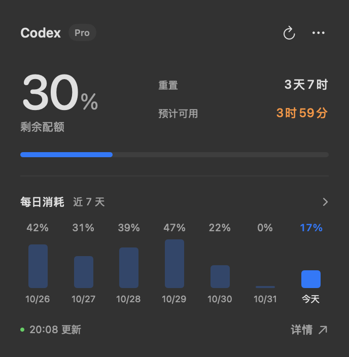

# codex-using

轻量的原生 macOS 菜单栏用量工具，应用名称为「GPT 用量」。集中查看 Codex / ChatGPT 账户的剩余配额、重置时间与消耗趋势。

[下载最新版](https://github.com/ZWLFI/codex-using/releases/latest)

<p>
  
  
</p>

截图使用示例数据。

## 功能

- 菜单栏剩余百分比，紧凑弹窗显示重置时间和预计可用时长
- 多配额切换、七日配额消耗图、每日 token 历史及 CSV / JSON 导出
- 配额阈值、重置和耗尽预测通知，支持安静时段
- 本地缓存、登录时启动、手动刷新（⌘R）与诊断信息
- 原生 SwiftUI 界面，适配浅色和深色外观

## 安装

需要 **Apple Silicon Mac、macOS 13 或更新版本**，以及本机已登录的 Codex。当前发布包仅包含 `arm64` 架构。

1. 从 [Releases](https://github.com/ZWLFI/codex-using/releases/latest) 下载 `codex-using-v2.7.0-macos-arm64.zip`。
2. 解压，将「GPT 用量.app」拖入「应用程序」文件夹。
3. 打开应用，点击菜单栏中的 GPT 读数。

应用使用本地 ad-hoc 签名，尚未经过 Apple Developer ID 签名与公证。首次打开若被 macOS 拦截，可在核对下载来源后，通过「系统设置 → 隐私与安全性 → 仍要打开」放行此应用。

## 从源码构建

需要 Apple Silicon Mac 与 Xcode Command Line Tools（`xcode-select --install`）。不需要第三方依赖。

```bash
git clone https://github.com/ZWLFI/codex-using.git
cd codex-using
./build.sh
./install.sh
```

构建产物位于 `dist/GPT 用量.app`。`build.sh` 会运行内置自检；`install.sh` 会先将旧应用和偏好数据备份到 `backups/`，再安装到 `/Applications` 并启动。

## 数据说明

应用通过本机 `codex app-server` 读取 `account/rateLimits/read` 和 `account/usage/read`，不直接读取 cookie、OAuth token、API key、会话或项目内容，也不上传本地用量到其他服务。

- 每日 token 来自 Codex 返回的数据；未结算日期不会补零。
- 七日配额消耗图来自本地连续观测的百分比增量；未记录日期显示 `—`，跨周期累计可能超过 100%。
- 耗尽时间按近期样本估算，使用速度变化时预测也会变化。
- 自动刷新间隔为 5 分钟；失败时保留缓存并标明状态。
- 历史范围按最近有数据的 7 / 30 / 90 条日记录统计，导出采用相同口径。

缓存保存在 `~/Library/Application Support/GPT 用量/`，不包含登录凭据。本项目为独立工具，与 OpenAI 无隶属关系。

## 故障排查

若提示找不到 Codex，请确认已安装并登录。程序会检查 ChatGPT 应用内置 CLI 和 `/opt/homebrew/bin/codex`、`/usr/local/bin/codex`、`~/.local/bin/codex` 等位置。所用 Codex 版本须支持上述用量接口。

在「设置 → 诊断」可查看读取失败原因。分享诊断前请检查其中的本机路径和错误信息。

## 验证范围

已完成本机构建、自检、深浅色与空数据渲染检查，以及实时数据读取、弹窗详情和页面切换验证。macOS 13 为构建最低目标版本，尚未逐一验证所有系统版本；系统通知和导出落盘尚未完成端到端回归。
